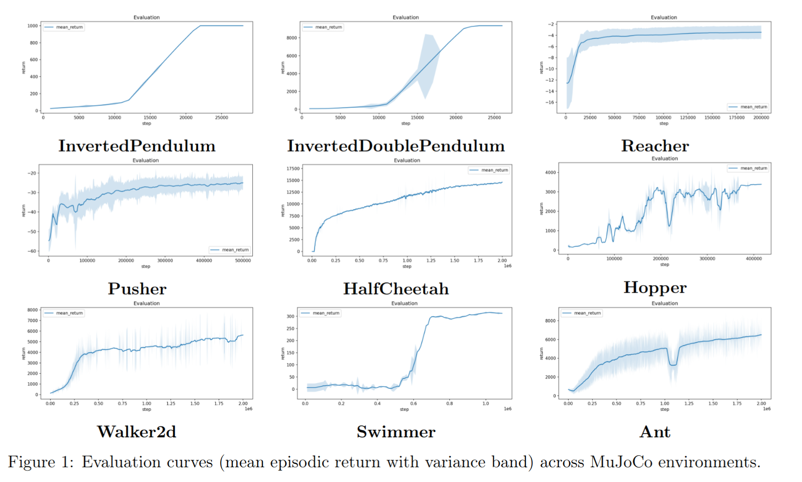
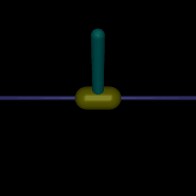
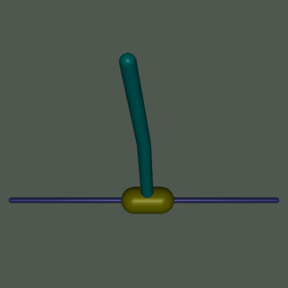

# sac-gymnasium

Soft Actor-Critic (SAC) implemented from scratch in Python/PyTorch, tested on Gymnasium MuJoCo continuous-control environments. Automatic entropy tuning, twin critics, gradient clipping, and numerically stable log-probability computation. No RL frameworks — plain PyTorch and Gymnasium.

Layout
------
- `sac/` — actor, critic, agent, replay buffer, config, logging utilities
- `train.py`, `eval.py`, `play.py`, `make_gif.py`, `log_analysis.py` — entry points
- `configs/` — YAML hyperparameter files
- `docker/` — Dockerfile and run.sh

Results
-------
Mean episode return across 9 MuJoCo environments (ordered by difficulty):



Environments: InvertedPendulum-v5, InvertedDoublePendulum-v5, Reacher-v5, Pusher-v5, HalfCheetah-v5, Hopper-v5, Walker2d-v5, Swimmer-v5, Ant-v5.

Each `results/<Env>/` holds the run config, train/eval CSVs and plots. Where present, `results/<Env>/checkpoint/` is the final trained agent:

```
python eval.py --agent results/InvertedPendulum_v5/checkpoint --max_steps_per_episode 1000
python play.py --agent results/InvertedPendulum_v5/checkpoint
```

| InvertedPendulum-v5 | InvertedDoublePendulum-v5 |
|---|---|
|  |  |

Docker
------
Build from the project root (Dockerfile lives in `docker/`):

```
docker build -t sac-gymnasium -f docker/Dockerfile .
```

Run with X11 forwarding and project mounted at `/sac-gymnasium`:

```
bash docker/run.sh
```

Usage
-----
Training:

```
python train.py --env HalfCheetah-v5 --total_steps 1000000
python train.py --config configs/default.yaml --env Ant-v5 --seed 1 --total_steps 3000000
python train.py --resume checkpoints/HalfCheetah_v5/run_<ts>/latest
```

Evaluation (headless):

```
python eval.py --agent checkpoints/HalfCheetah_v5/run_<ts>/latest --episodes 10
python eval.py --agent random --env HalfCheetah-v5
```

Playback (rendered, requires display):

```
python play.py --agent checkpoints/HalfCheetah_v5/run_<ts>/latest --episodes 3
```

Rollout GIF (headless, needs an offscreen OpenGL backend such as OSMesa):

```
MUJOCO_GL=osmesa python make_gif.py --agent results/InvertedPendulum_v5/checkpoint --out results/InvertedPendulum_v5/policy.gif
MUJOCO_GL=osmesa python make_gif.py --agent results/InvertedDoublePendulum_v5/checkpoint --out results/InvertedDoublePendulum_v5/policy.gif --camera_distance 2.2 --camera_lookat_z 0.6
```

Log analysis:

```
python log_analysis.py --log_dir logs/HalfCheetah_v5/run_<ts> --smooth 10 --save
```

Key CLI flags
-------------
train.py: `--config`, `--env`, `--seed`, `--total_steps`, `--resume`
eval.py:  `--agent` (zero|random|PATH), `--env`, `--episodes`, `--policy` (deterministic|stochastic)
play.py:  `--agent`, `--env`, `--episodes`, `--policy`, `--speed`

References
----------
- Haarnoja et al., [Soft Actor-Critic: Off-Policy Maximum Entropy Deep Reinforcement Learning with a Stochastic Actor](https://arxiv.org/abs/1801.01290), 2018
- [Gymnasium](https://gymnasium.farama.org/)
