# sac-gymnasium

Soft Actor-Critic (SAC) implemented from scratch in Python/PyTorch, tested on Gymnasium MuJoCo continuous-control environments. Automatic entropy tuning, twin critics, gradient clipping, and numerically stable log-probability computation. No RL frameworks — plain PyTorch and Gymnasium.

Layout
------
- `sac/` — actor, critic, agent, replay buffer, config, logging utilities
- `train.py`, `eval.py`, `play.py`, `make_gif.py`, `log_analysis.py` — entry points
- `configs/` — YAML hyperparameter files
- `test/` — pytest suite
- `docker/` — Dockerfile and run.sh

Results
-------
Mean episode return across 9 MuJoCo environments (ordered by difficulty):

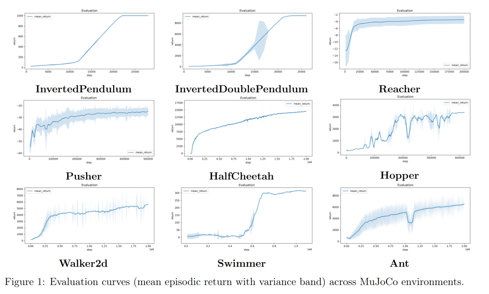

Environments: InvertedPendulum-v5, InvertedDoublePendulum-v5, Reacher-v5, Pusher-v5, HalfCheetah-v5, Hopper-v5, Walker2d-v5, Swimmer-v5, Ant-v5.

Humanoid-v5 was added later (not in the figure): 5758 ± 20 return at 2M steps (independent eval, 20 episodes, seed 1234, all episodes run the full 1000 steps). Curve: `results/Humanoid_v5/eval_metrics.png`.

Each `results/<Env>/` holds the run config, train/eval CSVs and plots, and `checkpoint/` with the final trained agent. Hopper and Walker2d become less stable late in training, so they also keep `checkpoint_best/`, the periodic checkpoint with the best independent eval (20 episodes, seed 1234): Hopper at 1M steps (3515 ± 20 vs 3143 ± 447 final), Walker2d at 1.8M steps (4891 ± 29 vs 2851 ± 2346 final). Their GIFs show `checkpoint_best/`.

```
python eval.py --agent results/InvertedPendulum_v5/checkpoint --max_steps_per_episode 1000
python play.py --agent results/InvertedPendulum_v5/checkpoint
```

| InvertedPendulum-v5 | InvertedDoublePendulum-v5 | Reacher-v5 |
|---|---|---|
| 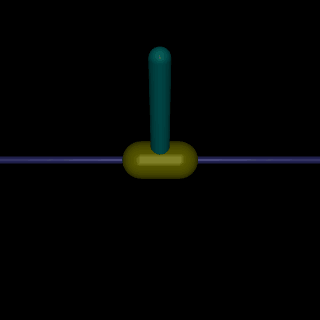 | 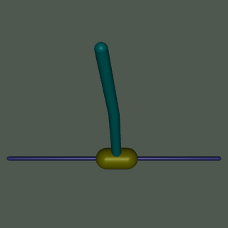 | 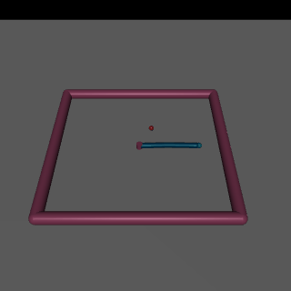 |
| **Pusher-v5** | **HalfCheetah-v5** | **Hopper-v5** |
| 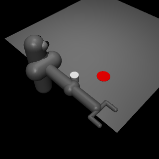 | 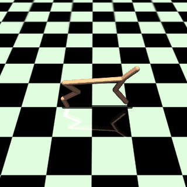 | 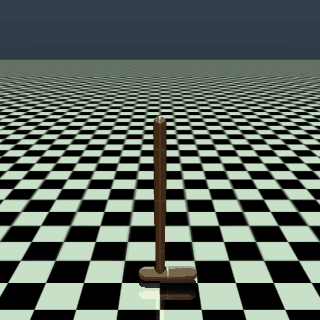 |
| **Walker2d-v5** | **Swimmer-v5** | **Ant-v5** |
| 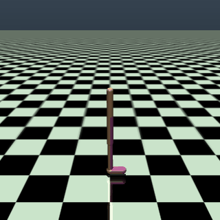 | 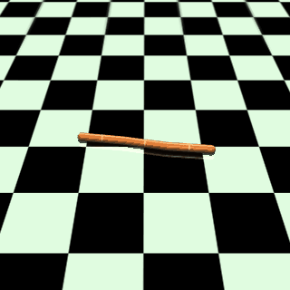 | 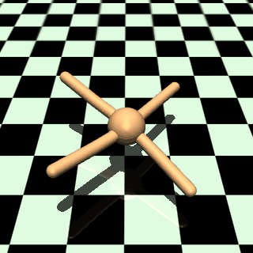 |
| **Humanoid-v5** | | |
| 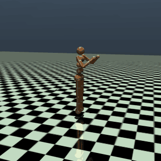 | | |

Docker
------
Build from the project root (Dockerfile lives in `docker/`):

```
docker build -t sac-gymnasium -f docker/Dockerfile .
```

Run with X11 forwarding and project mounted at `/sac-gymnasium`:

```
bash docker/run.sh
```

Usage
-----
Training:

```
python train.py --env HalfCheetah-v5 --total_steps 1000000
python train.py --config configs/default.yaml --env Ant-v5 --seed 1 --total_steps 3000000
python train.py --resume checkpoints/HalfCheetah_v5/run_<ts>/latest
```

Evaluation (headless):

```
python eval.py --agent checkpoints/HalfCheetah_v5/run_<ts>/latest --episodes 10
python eval.py --agent random --env HalfCheetah-v5
```

Playback (rendered, requires display):

```
python play.py --agent checkpoints/HalfCheetah_v5/run_<ts>/latest --episodes 3
```

Rollout GIF (headless, needs an offscreen OpenGL backend such as OSMesa):

```
MUJOCO_GL=osmesa python make_gif.py --agent results/InvertedPendulum_v5/checkpoint --out results/InvertedPendulum_v5/policy.gif
MUJOCO_GL=osmesa python make_gif.py --agent results/InvertedDoublePendulum_v5/checkpoint --out results/InvertedDoublePendulum_v5/policy.gif --camera '{"trackbodyid": 0, "distance": 2.2, "lookat": [0, 0, 0.6]}'
MUJOCO_GL=osmesa python make_gif.py --agent results/Reacher_v5/checkpoint --out results/Reacher_v5/policy.gif --episodes 6
MUJOCO_GL=osmesa python make_gif.py --agent results/Pusher_v5/checkpoint --out results/Pusher_v5/policy.gif --episodes 3 --camera '{"trackbodyid": -1, "distance": 2.2, "elevation": -50, "azimuth": 135, "lookat": [0.3, -0.3, -0.3]}'
MUJOCO_GL=osmesa python make_gif.py --agent results/Swimmer_v5/checkpoint --out results/Swimmer_v5/policy.gif --track --steps 400 --frame_skip 4
MUJOCO_GL=osmesa python make_gif.py --agent results/HalfCheetah_v5/checkpoint --out results/HalfCheetah_v5/policy.gif --track --steps 60 --frame_skip 1
MUJOCO_GL=osmesa python make_gif.py --agent results/Hopper_v5/checkpoint_best --out results/Hopper_v5/policy.gif --track --steps 400 --frame_skip 8
MUJOCO_GL=osmesa python make_gif.py --agent results/Walker2d_v5/checkpoint_best --out results/Walker2d_v5/policy.gif --track --steps 400 --frame_skip 8
MUJOCO_GL=osmesa python make_gif.py --agent results/Ant_v5/checkpoint --out results/Ant_v5/policy.gif --track --steps 100 --frame_skip 2
MUJOCO_GL=osmesa python make_gif.py --agent results/Humanoid_v5/checkpoint --out results/Humanoid_v5/policy.gif --track --steps 240 --frame_skip 4 --camera '{"trackbodyid": 1, "distance": 4.5, "elevation": -12, "azimuth": 110, "lookat": [0, 0, 0.9]}'
```

Log analysis:

```
python log_analysis.py --log_dir logs/HalfCheetah_v5/run_<ts> --smooth 10 --save
```

Action bounds
-------------
The policy outputs actions in `[-1, 1]`. With `rescale_actions: true` they are mapped linearly onto the environment's bounds; with the default `false` they are only clipped to them. Rescaling matters when the bounds are narrower than `[-1, 1]` (Humanoid: `[-0.4, 0.4]`). The flag is stored in the checkpoint, so `eval.py`, `play.py` and `make_gif.py` apply it automatically.

Humanoid
--------
`configs/10_humanoid_v5.yaml` differs from the other configs in two ways:

- `rescale_actions: true`. With `train_freq: 1`, a run without it stays around 400 return (episodes of ~100 steps) after 300k steps, against 3000-4700 with it.
- `train_freq: 2`. On CPU an update costs ~40x an environment step, so halving the update rate doubles the environment steps per hour. Over the same 1M updates (about 6 h on one core), `train_freq: 1` reached 5004 ± 849 at 1M steps, after a transient collapse to near-zero return at 970k steps; `train_freq: 2` reached 5758 ± 20 at 2M steps without such a collapse.

The run in `results/Humanoid_v5/` (seed 0) was launched with `total_steps: 4000000` and stopped at 2M; `checkpoint/` is the 2M-step periodic checkpoint.

Caveats:

- The comparison runs (`train_freq: 1`, no `rescale_actions`, and a second seed of the `train_freq: 2` config) are not versioned: only `results/Humanoid_v5/` keeps logs and checkpoints. The second seed reached 5522 ± 110 at 1.4M steps (independent eval, same protocol) and was then stopped.
- Evaluation is not monotonic: between 1.1M and 1.9M steps several periodic checkpoints of the kept run score 3500-5200 with large spread because some episodes fall early. The 2M checkpoint is a stable point, with no guarantee it stays so with more training.
- Humanoid-v5 has no registered reward threshold in Gymnasium. About 5 of each step's reward is the healthy bonus, so a full 1000-step episode already scores ~5000; 5758 means walking upright for the whole episode at moderate forward speed.

Key CLI flags
-------------
train.py: `--config`, `--env`, `--seed`, `--total_steps`, `--resume`
eval.py:  `--agent` (zero|random|PATH), `--env`, `--episodes`, `--policy` (deterministic|stochastic)
play.py:  `--agent`, `--env`, `--episodes`, `--policy`, `--speed`

References
----------
- Haarnoja et al., [Soft Actor-Critic: Off-Policy Maximum Entropy Deep Reinforcement Learning with a Stochastic Actor](https://arxiv.org/abs/1801.01290), 2018
- [Gymnasium](https://gymnasium.farama.org/)
